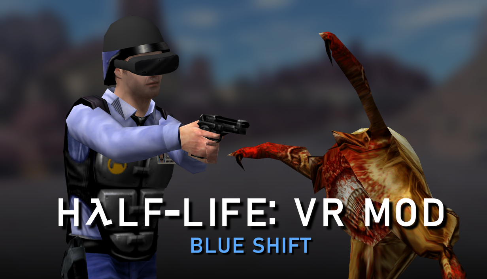
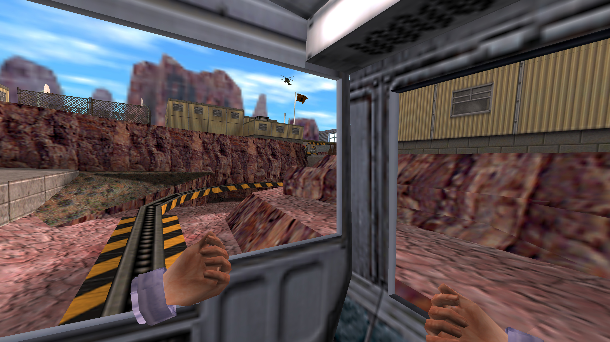
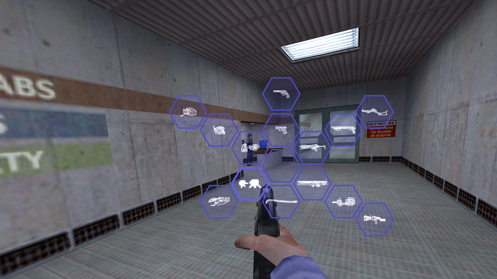
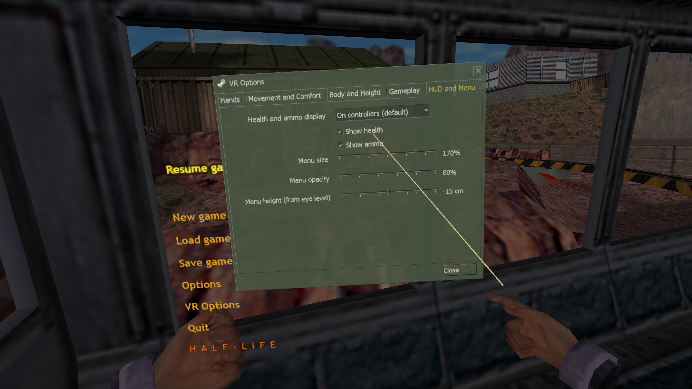
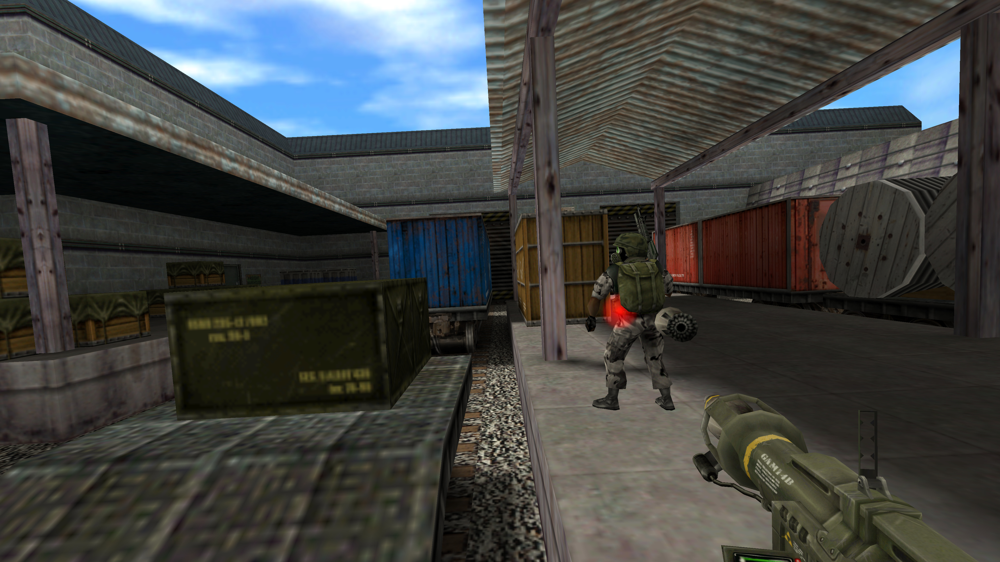
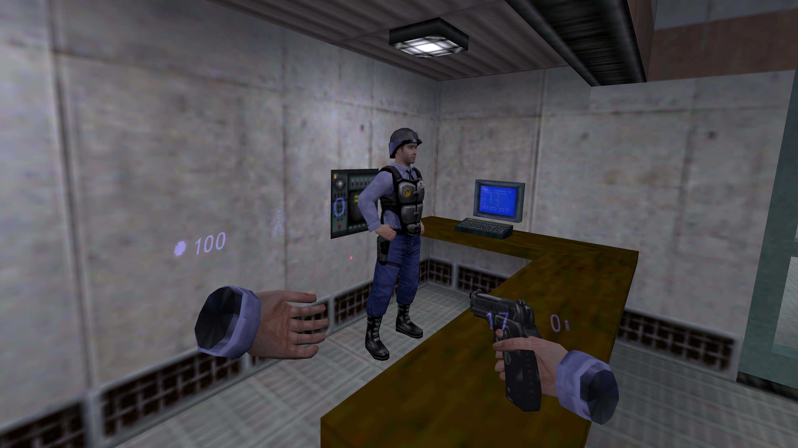
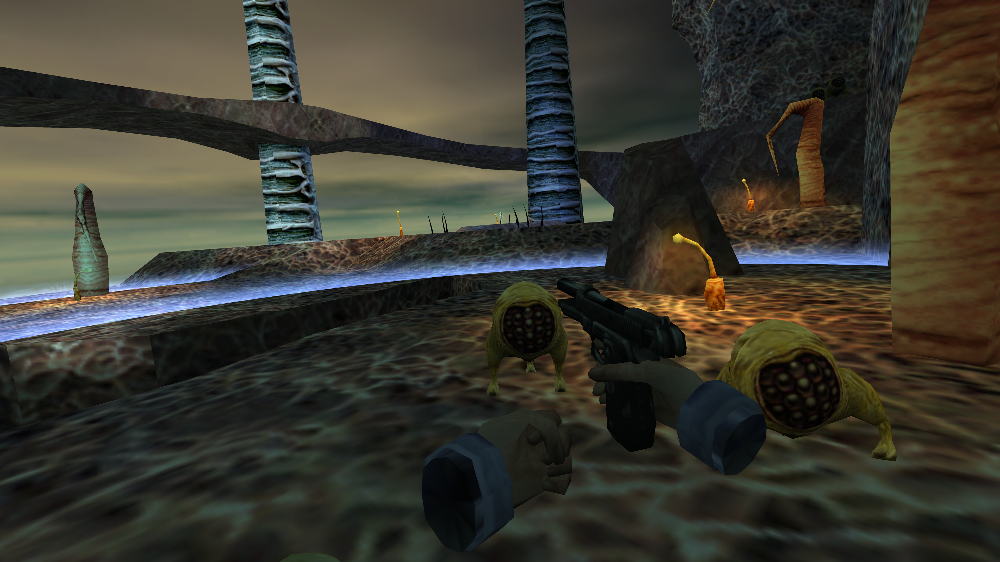

<p align="center">
  
</p>

<p align="center">
  <b>Play Half-Life: Blue Shift in virtual reality as Barney Calhoun.</b><br>
  A free community VR mod based on Max Makes Mods' <a href="https://github.com/maxmakesmods/Half-Life-VR">Half-Life: VR Mod</a>.
</p>

<p align="center">
  <a href="https://github.com/inf-ee/Blue-Shift-VR/releases/latest"></a>
  <a href="https://github.com/inf-ee/Blue-Shift-VR/releases"></a>
  
  
</p>

<p align="center">
  <a href="#installation">Installation</a> ·
  <a href="#features">Features</a> ·
  <a href="#status">Status</a> ·
  <a href="#known-issues">Known issues</a> ·
  <a href="#credits">Credits</a> ·
  <a href="#development">Development</a>
</p>

This is a free, non-commercial community project. It is not affiliated with, endorsed by, or supported by Valve Corporation or Gearbox Software. Playing it requires owning [Half-Life](https://store.steampowered.com/app/70/HalfLife/) and [Half-Life: Blue Shift](https://store.steampowered.com/app/130/HalfLife_Blue_Shift/) on Steam. Half-Life and Blue Shift are trademarks of Valve Corporation.

# Screenshots

<table>
  <tr>
    <td width="33%"><a href="art/steam_screenshots/01_tram_canyon.jpg"></a><p align="center"><sub>The tram ride to work</sub></p></td>
    <td width="33%"><a href="art/steam_screenshots/02_weapon_wheel.jpg"></a><p align="center"><sub>Weapon wheel</sub></p></td>
    <td width="33%"><a href="art/steam_screenshots/03_menu_vr_options.jpg"></a><p align="center"><sub>The game's menu and VR Options, inside VR</sub></p></td>
  </tr>
  <tr>
    <td width="33%"><a href="art/steam_screenshots/04_rpg.jpg"></a><p align="center"><sub>Rocket launcher vs. HECU</sub></p></td>
    <td width="33%"><a href="art/steam_screenshots/05_security_hud.jpg"></a><p align="center"><sub>Health and ammo on your hands</sub></p></td>
    <td width="33%"><a href="art/steam_screenshots/06_xen_houndeyes.jpg"></a><p align="center"><sub>Houndeyes in Xen</sub></p></td>
  </tr>
</table>

# Features

- **The whole Blue Shift campaign in VR** with motion-controlled weapons and Barney's own VR hands.
- **Weapon wheel** for picking weapons with your controller.
- **The game's own menu in VR.** It floats in front of you over the paused game, and you point at it with your controller. No need to take the headset off.
- **VR Options** inside that menu: hands, movement and comfort, body and height, gameplay, HUD and menu.
- **Health and ammo on your controllers.**
- **SD and HD weapon models**, following the game's own HD models option.
- **One-click installer** that finds Steam and your games and sets everything up.

# Status

Beta. Most of the code is ported from Half-Life: VR Mod onto the latest SDK. For what's not ported, see [Differences](#differences-from-half-life-vr-mod). Hand models are replaced. There are likely still bugs introduced by the migration.

## Differences from Half-Life: VR Mod

- Runs on the Half-Life 25th Anniversary Update engine and the latest community SDK instead of the legacy SDK.
- Original content only, no new NPC models or voice lines.
- Upscaled textures are not shipped with this mod.
- FMOD sound engine is not ported.
- Speech recognition is not ported.
- Steam API and achievements are not ported.
- The VR configuration tool is not ported. Settings are in the in-game VR Options instead.
- Configuration changes are:
  - Immersive ladders are disabled by default.
  - Default movement direction is HMD.
  - Autocrouch is disabled by default.
  - Aim laser is enabled by default.
  - World scale is 0.97 instead of 1.

# Known issues

## In this mod

- Hand models on weapons are mess.
- Linux support is experimental, see [Linux](#linux-experimental).

## Inherited from Half-Life: VR Mod

- Immersive ladders are hard to climb and properly dismount.
- The mod may crash on launch, during level transitions or at random, and may corrupt saves.
- No manual reload or two-hand weapon holding.
- Any other known issues of the original mod.

# Installation

1. Make sure you have [Half-Life](https://store.steampowered.com/app/70/HalfLife/) and [Half-Life: Blue Shift](https://store.steampowered.com/app/130/HalfLife_Blue_Shift/) installed on Steam. The mod runs on the Half-Life engine, so Steam lists it under Half-Life, which you need even if you only play Blue Shift.
2. Download the installer from the latest release on the [Releases](https://github.com/inf-ee/Blue-Shift-VR/releases) page: `bsvr-install-<version>.exe` for Windows, `bsvr-install-<version>-linux` for Linux.
3. Launch the installer. It looks for your Steam installations and installs the mod. On Linux, run it from a terminal, see below.
4. Restart the Steam client (tray icon right click → Exit Steam, or Steam → Exit in the top menu).
5. The mod appears in your Steam library as **Half-Life: VR Mod - Blue Shift**.

To update, run the installer of a newer release. It updates the installed mod in place; Steam can keep running.

## Linux (experimental)

The mod runs natively on Linux with SteamVR for Linux. It should work, but has only been tested on one setup so far (Intel graphics, KDE Plasma on Wayland, Quest 2 over Steam Link). Reports from other setups are welcome.

Requirements:

- **SteamVR** for Linux.
- **Half-Life running natively** (the default). If you force Proton on Half-Life instead, the installer installs the Windows version of the mod, which then runs under Proton.
- **32-bit OpenGL drivers**, normally installed together with Steam.

Running the installer: browsers don't keep the executable flag of downloads, so set it first. In a terminal, in the folder you downloaded it to:

```
chmod +x bsvr-install-<version>-linux
./bsvr-install-<version>-linux
```

Known issues on Linux:

- On Wayland, pointing at the in-game menu only works while the desktop mouse cursor is over the game window.
- Changing the HD models option (Options → Advanced) during a game crashes the game.

# Credits

## Half-Life: VR Mod

The VR code in this mod (`dlls/vr`, `cl_dll/vr`, `game_shared/vr` and the `BSVR` sections) and the VR assets the installer ships (controller bindings, HUD textures, skyboxes, the flashlight sprite and the train button sound) come from [Half-Life: VR Mod](https://github.com/maxmakesmods/Half-Life-VR), (c) 2017-2022 Max Makes Mods, reused with the authors' permission. Contributors to its repository:

- Max Makes Mods
- Devin (formicsapien)
- rorincloud
- Cyril Paulus

Thanks to the Half-Life: VR Mod supporters and beta testers listed in its [README](https://github.com/maxmakesmods/Half-Life-VR/blob/main/docs/README.md).

## Blue Shift Updated

This mod is built on the [Blue Shift Updated](https://github.com/twhl-community/halflife-bs-updated) SDK by the TWHL community. The Blue Shift game code there is a community reimplementation, not Gearbox or Valve source. Thanks to everyone who contributed to it:

Sam Vanheer, JoelTroch, malortie, dtugend, Revenant100, fel1x-developer, LogicAndTrick, FreeSlave, zpl-zak, edgarbarney, Toodles2You, Jengerer, thefoofighter, Maxxiii, johndrinkwater, anchurcn, DanielOaks, MegaBrutal, suXinjke, IntriguingTiles, Oxofemple, YaLTeR, Ronin4862, the man, vasiavasiavasia95, NongBenz, Hezus, Anton, ArroganceJustified, a1batross, zaklaus, Uncle Mike, Bacontsu, L453rh4wk, P38TaKjYzY, hammermaps, LuckNukeHunter99, Veinhelm, jay!, BryanHaley, λλλλλλ, Streit, rbar1um43, LambdaLuke87, almix, sabian.

Special thanks: Valve Software, Gearbox Software, Alfred Reynolds, mikela-valve, the TWHL community, Knockout, Gamebanana, ModDB.

## hl1_source_sdk

The VR Options dialog in the game's menu uses VGUI2 from [hl1_source_sdk](https://github.com/tmp64/hl1_source_sdk) by tmp64: parts of Valve's Source SDK 2013 ported to the Half-Life engine, based on Sam Vanheer's reverse engineering of the engine.

## Third-party code

Third-party code and licenses are listed in [THIRD_PARTY_LICENSES](THIRD_PARTY_LICENSES/README.md).

# Development

For building and installing follow the upstream [Blue Shift Updated](https://github.com/twhl-community/halflife-bs-updated#readme) documentation.

- **Windows:** `projects/vs2019/hldll.vcxproj` and `hl_cdll.vcxproj`.
- **Linux (32-bit, experimental):** `linux/build-steamrt.sh` builds `release/hl.so` and `release/client.so` in the Steam Runtime container (needs docker); this is how releases are built. A plain `cd linux && make` works for testing, but only on systems with the same or a newer glibc.
- **Installer:** see [installer/README.md](installer/README.md).
- **Releases:** pushing a `v*` tag runs [.github/workflows/release.yml](.github/workflows/release.yml), which builds both platforms and both installers and creates a draft release.
